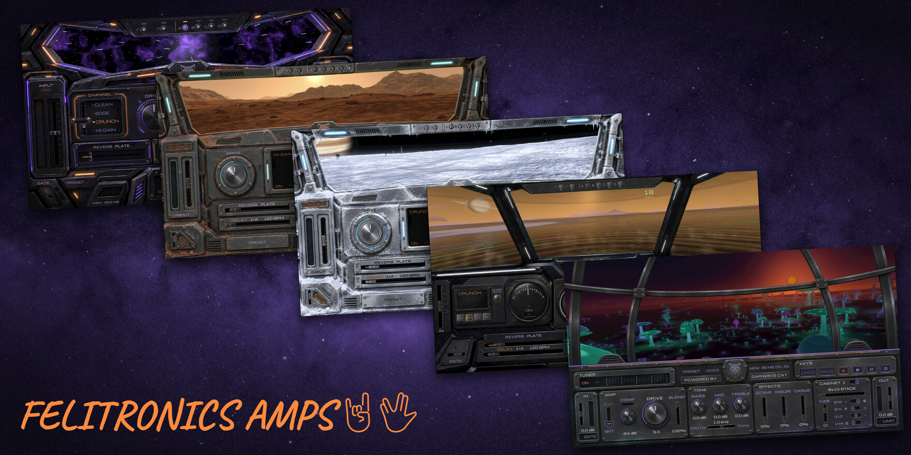
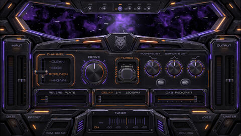
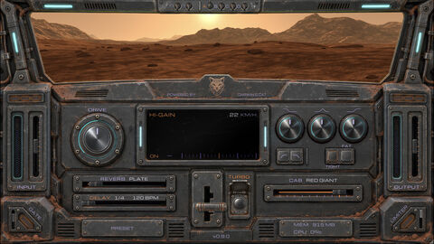
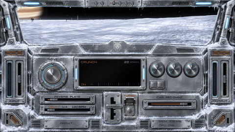
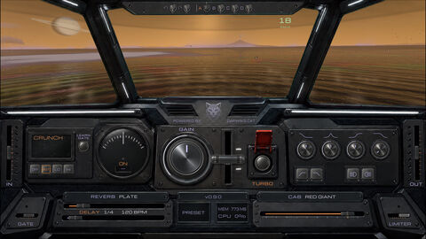
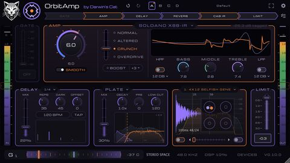
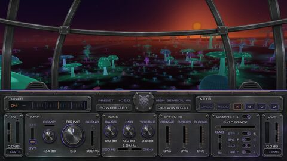
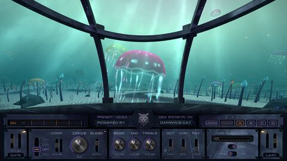
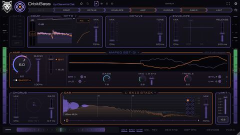

# Felitronics Amps

Free, open-source guitar and bass amp plugins, ready to play. VST3, AU and CLAP plugins and a standalone app for
Windows, macOS and Linux. This repository builds them all: OrbitAmp, CatpitAmp, RedPawAmp,
FrostPawAmp and AmberPawAmp for the guitar, OrbitBass, RedGrooveBass and DeepGrooveBass for the bass.
All of them are tuned and calibrated to our taste by Darwin's Cat.

## Play them in your browser

Six of the amps run right on their pages, in the browser: the plugin itself, playing our riffs, with its channels,
knobs and cabinet live. Nothing to install.

| | Amp | The real amp inside | |
|---|---|---|---|
|  | **[CatpitAmp](https://darwinscat.com/felitronics/amps/catpitamp)** flies a starship | Soldano X88-IR, the sound of the SLO-100 line: four channels, CLEAN, EDGE, CRUNCH and HI-GAIN | **[Live demo](https://darwinscat.com/felitronics/amps/catpitamp)** |
|  | **[RedPawAmp](https://darwinscat.com/felitronics/amps/redpawamp)** drives across Mars | Friedman IR-X, the Friedman BE-100 in its IR-X form: 86 captures | **[Live demo](https://darwinscat.com/felitronics/amps/redpawamp)** |
|  | **[FrostPawAmp](https://darwinscat.com/felitronics/amps/frostpawamp)** across the ice of Europa | Two Notes ReVolt Guitar: three channels based on the Fender Bassman 100, the Marshall JMP Super Lead and the Soldano SLO-100 | **[Live demo](https://darwinscat.com/felitronics/amps/frostpawamp)** |
|  | **[AmberPawAmp](https://darwinscat.com/felitronics/amps/amberpawamp)** flies over Titan | Victory V4 tube preamps: The Copper, The Sheriff and The Kraken, one for each gear | **[Live demo](https://darwinscat.com/felitronics/amps/amberpawamp)** |
|  | **[OrbitAmp](https://darwinscat.com/felitronics/amps/orbitamp)** every guitar amp above in one plugin | All four, picked from a menu: the sound changes without changing the plugin | [Page](https://darwinscat.com/felitronics/amps/orbitamp) |
|  | **[RedGrooveBass](https://darwinscat.com/felitronics/bass-amps/redgroovebass)** in a walker's cabin | Ampeg SGT-DI with both its voices, SVT and B15 | **[Live demo](https://darwinscat.com/felitronics/bass-amps/redgroovebass)** |
|  | **[DeepGrooveBass](https://darwinscat.com/felitronics/bass-amps/deepgroovebass)** in a bathyscaphe, in the ocean of another planet | Two Notes ReVolt Bass: three channels, Classic Clean, Vintage Dirt and Modern Drive | **[Live demo](https://darwinscat.com/felitronics/bass-amps/deepgroovebass)** |
|  | **[OrbitBass](https://darwinscat.com/felitronics/bass-amps/orbitbass)** every bass amp in one plugin | The whole bass chain on one studio panel | [Page](https://darwinscat.com/felitronics/bass-amps/orbitbass) |

## What is inside

**Every amp**

- **Gate.** It listens to the clean signal at the input and mutes after the amp, so it cuts the noise the amp adds
  too. LEARN sets its threshold from three seconds of silence.
- **The amp's own EQ**, the real device's tone stack, and **HPF / LPF**.
- **IR loader.** Our cabinets, synthesized by [Orbit Guitar Cab Builder and Orbit Bass Cab Builder](https://github.com/darwinscat/cab-ir-generator),
  or drop your own IR onto CAB.
- **True-peak limiter** at the output.
- **Undo / redo and A/B/C/D**: four settings to compare, each with its own full history.
- A tuner and presets of your own.

**Guitar:** six reverbs, Ambience, Room, Hall, Plate, Spring and Modulated, and a delay synced to the DAW's tempo,
with tap tempo in the standalone app.

**Bass:** a compressor, an octaver and a chorus around the preamp.

## How the sound is made

Every amp plays real hardware that we captured ourselves with Neural Amp Modeler (NAM A2). The captures can be
downloaded on their own, for any NAM player: [NAM captures](https://darwinscat.com/felitronics/nam). The cabinets' impulse responses too:
[free cabinet IRs](https://darwinscat.com/felitronics/ir).

## Download

Two packages on the [Releases](https://github.com/darwinscat/orbit-amp/releases) page, each carrying its amps as
VST3, AU (macOS) and CLAP plugins and as standalone apps:

- **Darwin's Cat Amps**, tags `vX.Y.Z`: OrbitAmp, CatpitAmp, RedPawAmp, FrostPawAmp, AmberPawAmp.
- **Darwin's Cat Bass**, tags `bass-vX.Y.Z`: OrbitBass, RedGrooveBass, DeepGrooveBass.

macOS: a `.pkg`. Windows: an installer `.exe` for x64, a `.zip` for x64 and for arm64. Linux: a `.tar.xz` for
x86_64 and for arm64. The amps' pages carry the same files, with what changed in each version.

## Captures and impulse responses

The code is AGPL-3.0. The NAM captures and cabinet impulse responses are made by Darwin's Cat and are
under terms of their own, [resources/CONTENT-LICENSE.md](resources/CONTENT-LICENSE.md): play, record,
perform and sell your music freely; share the files, changed or not, free of charge and with credit; put them only in a program or device
whose source is published under a GPL-compatible licence, with credit, or in a closed product with
written permission.

## Third-party hardware

Third-party manufacturer and product names are used solely to identify the physical hardware
captured. Equipment photos are our own photographs of the actual captured units. All trademarks
belong to their respective owners. OrbitAmp is not affiliated with or endorsed by those
manufacturers.

The full notice is [docs/THIRD-PARTY-NOTICE.md](docs/THIRD-PARTY-NOTICE.md), and the plugin carries
it verbatim: the short form above at the foot of the version window, the full text under
**DEVICES & TRADEMARKS** in the gear menu, beside the list of every device the installed packs name.
